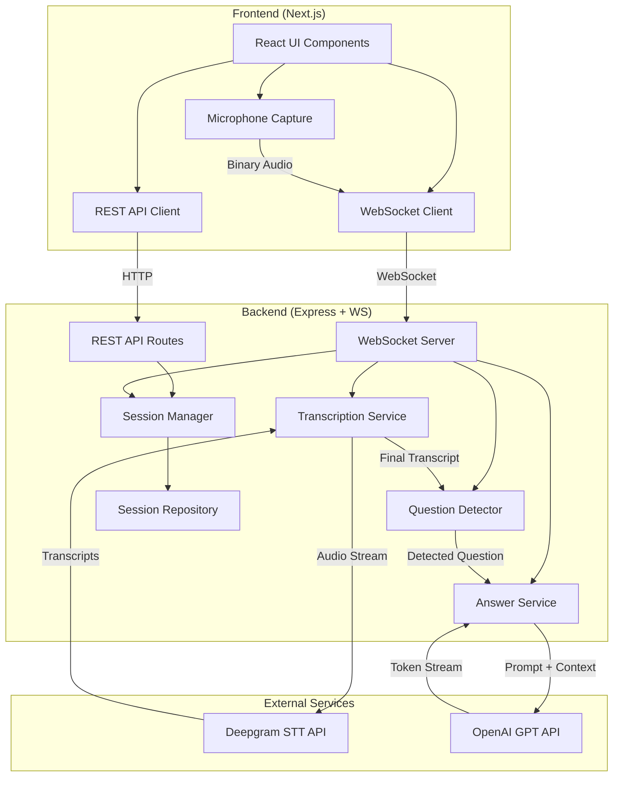
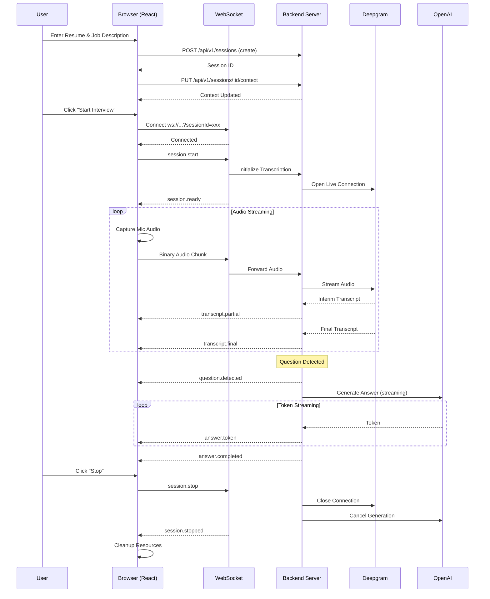

# Architecture Documentation

## System Architecture



## Data Flow Sequence



## Module Architecture

### Backend Modules

| Module | Responsibility |
|--------|---------------|
| **Health** | System health check endpoint |
| **Sessions** | Session CRUD, lifecycle management |
| **Transcription** | Deepgram integration, audio → text |
| **Questions** | Deterministic question detection |
| **Answers** | OpenAI integration, prompt building, streaming |

### Frontend Architecture

| Layer | Responsibility |
|-------|---------------|
| **Pages** | Route-level components, view orchestration |
| **Components** | Reusable UI elements |
| **Hooks** | State management, WebSocket, microphone |
| **Services** | REST API client |
| **Types** | Shared TypeScript interfaces |

## Technology Decisions

### Why WebSocket for Audio?
- Binary streaming without Base64 overhead
- Bidirectional for events (transcripts, answers)
- Lower latency than HTTP polling

### Why Deterministic Question Detection?
- No LLM call needed → faster response
- Punctuation + keyword heuristics are sufficient
- Avoids unnecessary API costs
- Predictable behavior

### Why MediaRecorder for Audio?
- Browser-native API with wide support
- Handles encoding/format automatically
- Deepgram supports container format detection
- Simpler than manual PCM via AudioWorklet

### Why In-Memory Sessions?
- No database setup complexity
- Sufficient for single-server interview sessions
- Sessions are short-lived (interview duration)
- Easy to extend to persistent storage later

## Latency Pipeline

```
User speaks → Mic captures (250ms chunks) → WebSocket → Backend → Deepgram
                                                                      ↓
UI ← answer.token ← Backend ← OpenAI streaming ← Question detected ← Final transcript
```

Target: < 3 seconds from question completion to first answer token.

Measured timestamps:
1. Last audio chunk received
2. Final transcript from Deepgram
3. Question detected
4. OpenAI request initiated
5. First answer token received
6. Answer completed

